# Physical Records Management System (PRMS) — Node.js & SQLite

[](https://nodejs.org/)
[](https://sqlite.org/)
[](https://react.dev/)
[](https://www.typescriptlang.org/)
[](https://vitejs.dev/)
[-success)](#technology-stack)

A secure, auditable, high-performance system of record for managing physical document cartons across outsourced vendor archival facilities: ownership, custody tracking, movement history, policy-driven retention calculations, legal hold enforcement, and vendor evidence reconciliation.

---

## 1. Project Overview & Problem Statement

Financial and enterprise organizations maintain tens of thousands of paper-based customer documents, credit files, loan agreements, audit records, and KYC dossiers packed into physical cartons and stored by external third-party storage vendors across geographically distributed warehouses. 

Managing this physical estate through manual spreadsheets, email chains, and separate vendor web portals results in critical operational risks:
- **Unverifiable Custody Handoffs**: Ambiguity regarding whether a carton is with the business department, in transit with a courier, or physically stored at a vendor warehouse facility.
- **Premature or Overdue Destruction**: Inability to calculate statutory retention dates dynamically, risking either the premature destruction of legally required records or paying endless storage fees for obsolete records.
- **Legal Hold Violations**: Unintentional disposal of records that are subject to active regulatory inquiry, subpoenas, or litigation.
- **Vendor Invoice Discrepancies**: Paying vendor storage charges and per-activity fees without independent reconciliation against internal physical handling events and contractual rate cards.

**PRMS** provides a single, immutable, trigger-protected system of record that unifies carton custody tracking, operational request workflows, compliance approvals, legal hold locks, and multi-way vendor reconciliation.

---

## 2. Key Features

- **Zero Runtime Dependencies on Backend**: Operates using Node's native built-in modules (`node:sqlite`, `node:http`, `node:crypto`). No external frameworks (Express, Fastify, Knex, ORMs) required.
- **Consolidated 16-Table Relational Schema**: A compact, efficient schema featuring a polymorphic reference table (`ref_lookup`), inlined billing/reconciliation evidence, and trigger-enforced audit immutability.
- **Append-Only Event Log & Projections**: Complete lifecycle history recorded in `event_log`. Denormalized carton status and warehouse locations are atomically synchronized inside `BEGIN IMMEDIATE` transactions.
- **Four-Role Access Control & Multi-Tenant Scoping**:
  - `BUSINESS`: Department-scoped carton registration, file indexing, and request dispatch.
  - `VENDOR`: Vendor-scoped operational work queue (acknowledge, collect, warehouse receipt, delivery, destruction). Carton file contents and PII are strictly redacted.
  - `COMPLIANCE`: Enterprise-wide legal hold management and independent destruction approval (enforcing separation of duties: requester cannot be approver).
  - `FACILITIES`: Enterprise-wide estate monitoring, rate card administration, and reconciliation run execution.
- **Dynamic Retention Scheduling**: The `carton_retention` database view dynamically computes destruction due dates based on document classification and archival policy rules without hardcoding dates.
- **Bulletproof Legal Hold Locks**: Prevents destruction requests on held cartons and re-checks hold status at the exact moment of physical destruction execution.
- **Idempotent Command Execution**: All state-modifying requests accept or derive deterministic idempotency keys to ensure network retries do not duplicate events or side effects.
- **Modern Responsive Frontend**: Interactive React 18 + Vite + TypeScript Single Page Application with dark theme styling, role-filtered navigation, and live API proxying.

---

## 3. Technology Stack

| Layer | Technologies & Native Modules | Notes |
| :--- | :--- | :--- |
| **Backend Runtime** | Node.js `>= 22.5.0` | Uses `--experimental-sqlite` for native `node:sqlite`. |
| **HTTP Transport** | `node:http` | Custom lightweight router (`router.js`) with JSON streaming and cookie parsing. |
| **Database Engine** | Embedded SQLite 3.40+ | Managed via `node:sqlite` (`DatabaseSync`) in WAL mode with busy timeout handling. |
| **Security & Auth** | `node:crypto` | Native `scrypt` password hashing, `timingSafeEqual`, 32-byte opaque session tokens, SHA-256 token digests. |
| **Testing** | `node:test`, `node:assert/strict` | Automated zero-dependency test runner with database isolation. |
| **Frontend Framework**| React 18.3.1, React Router 6.28.0 | Component-driven UI with stateful React Context auth. |
| **Bundler & Tooling** | Vite 6.0.3, TypeScript 5.6.3 | Fast HMR dev server with reverse-proxy support. |
| **Styling** | Vanilla Modern CSS | Responsive layout using CSS Grid, Flexbox, and CSS custom variables. |

---

## 4. Architecture Overview

PRMS strictly enforces a unidirectional layered architecture:

```mermaid
flowchart LR
    Browser["React SPA<br/>(Port 5173)"] -->|"HTTP /api Proxy<br/>HttpOnly Session"| Server["node:http Server<br/>(Port 8000)"]
    Server --> Router["HTTP Router<br/>(router.js & routes.js)"]
    Router --> Scope["Auth & Scope Guard<br/>(scope.js & auth_service.js)"]
    Scope --> Services["Domain Services<br/>(carton, request, hold, recon)"]
    Services --> Engine["Event Engine<br/>(event_engine.js)"]
    Services --> Repos["Repositories<br/>(All SQL)"]
    Engine --> Repos
    Repos --> Connection["DatabaseSync + tx()<br/>(BEGIN IMMEDIATE)"]
    Connection --> DB[("SQLite Database<br/>(prms.db)")]
```



For complete architectural specifications and data-flow sequence diagrams, consult [`docs/SYSTEM_ARCHITECTURE.md`](docs/SYSTEM_ARCHITECTURE.md).

---

## 5. Prerequisites

- **Node.js >= 22.5.0** (Node 24 LTS recommended) — Required for native `node:sqlite`. Verify via:
  ```bash
  node -v
  ```
- **npm** (included with Node.js) for frontend package installation.

---

## 6. Installation & Quickstart

### Step 1: Initialize Database
```bash
cd backend
npm run db:init
```
*This command executes [`src/db/init.js`](backend/src/db/init.js), applying [`schema.sql`](backend/src/db/schema.sql) (16 tables, retention view, triggers) and [`seed.sql`](backend/src/db/seed.sql) (vocabulary lookup data).*

### Step 2: Provision User Accounts
The reference seed data establishes organizational entities and vendors, but contains no plain-text passwords. Provision demo accounts across the four system roles:

```bash
# Business User (Branch Banking - Delhi Branch)
npm run seed:users -- --id U-BIZ --name "Dina Business" --email dina@example.com \
  --role BUSINESS --password demo --entity ENT-BRN --department DEP-BRN-DEL

# Vendor User (SecureVault Storage Pvt Ltd)
npm run seed:users -- --id U-VND --name "Victor Vendor" --email victor@sv.example \
  --role VENDOR --password demo --vendor VND-001

# Compliance Officer (Global Scope)
npm run seed:users -- --id U-CMP --name "Carla Compliance" --email carla@example.com \
  --role COMPLIANCE --password demo

# Facilities Team (Global Scope)
npm run seed:users -- --id U-FAC --name "Fay Facilities" --email fay@example.com \
  --role FACILITIES --password demo
```

### Step 3: Start the Backend API Server
```bash
cd backend
npm start
```
*Backend listens on `http://localhost:8000`. Test health status:*
```bash
curl http://localhost:8000/health
# {"status":"ok","database":"up","env":"development"}
```

### Step 4: Install & Start the Frontend
In a second terminal window:
```bash
cd frontend
npm install
npm run dev
```
*Vite launches on `http://localhost:5173/` and proxies all `/api` calls directly to `http://localhost:8000`.*

---

## 7. Configuration (`.env`)

Configuration settings are loaded via environment variables in [`backend/src/config.js`](backend/src/config.js). Create a `.env` file in `backend/` based on [`.env.example`](.env.example):

```bash
cp .env.example backend/.env
```

| Variable | Default Value | Description |
| :--- | :--- | :--- |
| `PRMS_PORT` | `8000` | Port for the Node backend HTTP server. |
| `PRMS_DATABASE_FILE` | `./prms.db` | File path to the SQLite database. |
| `PRMS_SESSION_SECRET` | Auto-generated per boot | Secret for session signing. Set fixed hex string in production. |
| `PRMS_SESSION_TTL_MINUTES`| `480` (8 hours) | Duration of user sessions. |
| `PRMS_SESSION_COOKIE` | `prms_session` | Name of the HttpOnly session cookie. |
| `PRMS_SECURE_COOKIES` | `false` | Enable `Secure;` cookie flag (must be `true` under HTTPS). |
| `PRMS_FRONTEND_ORIGIN` | `http://localhost:5173` | Allowed CORS origin. |
| `PRMS_ENV` | `development` | Environment mode (`development` or `production`). |
| `VITE_API_TARGET` | `http://localhost:8000` | Target URL proxied by Vite dev server. |

---

## 8. Running Automated Tests

Execute the automated test suite powered by `node:test`:
```bash
cd backend
npm test
```
All tests execute against isolated temporary SQLite databases in `os.tmpdir()` without modifying your local database.

---

## 9. Comprehensive Documentation Index

All technical and architectural documentation is available in the [`docs/`](docs/) directory:

| Document | Purpose & Contents |
| :--- | :--- |
| [**PROJECT_OVERVIEW.md**](docs/PROJECT_OVERVIEW.md) | Business problem definition, banking domain requirements, role matrix, and scope boundaries. |
| [**SYSTEM_ARCHITECTURE.md**](docs/SYSTEM_ARCHITECTURE.md) | Layered architecture, component responsibilities, request lifecycle, and sequence diagrams. |
| [**DATABASE_DOCUMENTATION.md**](docs/DATABASE_DOCUMENTATION.md) | Detailed 16-table data dictionary, Mermaid ERD, column constraints, triggers, and views. |
| [**API_DOCUMENTATION.md**](docs/API_DOCUMENTATION.md) | Complete REST API reference (21 endpoints), request/response schemas, and validation rules. |
| [**MODULES_AND_CODEBASE.md**](docs/MODULES_AND_CODEBASE.md) | Comprehensive source tree breakdown and step-by-step feature execution walkthroughs. |
| [**SETUP_AND_DEPLOYMENT.md**](docs/SETUP_AND_DEPLOYMENT.md) | Detailed local setup instructions, PM2/systemd production deployment, Nginx proxy, and troubleshooting. |
| [**TESTING.md**](docs/TESTING.md) | Test framework overview, test case analysis, manual API test guides, and test coverage. |
| [**SECURITY.md**](docs/SECURITY.md) | Cryptography, session hardening, SQL injection defenses, role/row scoping, and threat model. |
| [**TECHNICAL_DECISIONS.md**](docs/TECHNICAL_DECISIONS.md) | Architectural rationale: zero runtime dependencies, 37-to-16 table consolidation, WAL mode. |
| [**DEVELOPMENT_GUIDE.md**](docs/DEVELOPMENT_GUIDE.md) | Developer standards, adding new features, database updates, and PR review checklist. |
| [**KNOWN_ISSUES_AND_ROADMAP.md**](docs/KNOWN_ISSUES_AND_ROADMAP.md) | Known technical limitations, stubbed detection engines, and prioritized Phase roadmap. |
| [**demo.md**](docs/demo.md) | 10-minute end-to-end operational walkthrough and demonstration script. |

---

## 10. Troubleshooting

- **`DatabaseSync is not a constructor`**: Ensure Node.js version is `>= 22.5.0` (`node -v`). Older versions do not support built-in SQLite.
- **Port 8000 or 5173 occupied**: Check running background tasks or terminate existing node processes.
- **`401 UNAUTHORIZED: Session expired or invalid` after restarting server**: Set a static `PRMS_SESSION_SECRET` in `backend/.env` so sessions persist across restarts.
- **`SQLite error: database is locked`**: Close any external database GUI clients or CLI sessions that hold write locks on `prms.db`.

---

## 11. Known Limitations & Roadmap

- **Reconciliation Engines**: The run execution framework, fingerprinting, and exception tables are implemented, but automated scanning algorithms comparing vendor inventory feeds, calculating invoice arithmetic, and verifying certificates are stubs returning 0 findings.
- **Workbook Ingestion**: Schema support (`import_row`) and the sample dataset (`prms_hackathon_dataset_v2.xlsx`) are present, but the automated bulk Excel parsing script is planned for Phase 3.
- **Rate Window Validation**: Non-overlapping rate card effective dates are designed for the application layer but not yet implemented in a dedicated service route.

*See [`docs/KNOWN_ISSUES_AND_ROADMAP.md`](docs/KNOWN_ISSUES_AND_ROADMAP.md) for full technical debt and roadmap details.*
