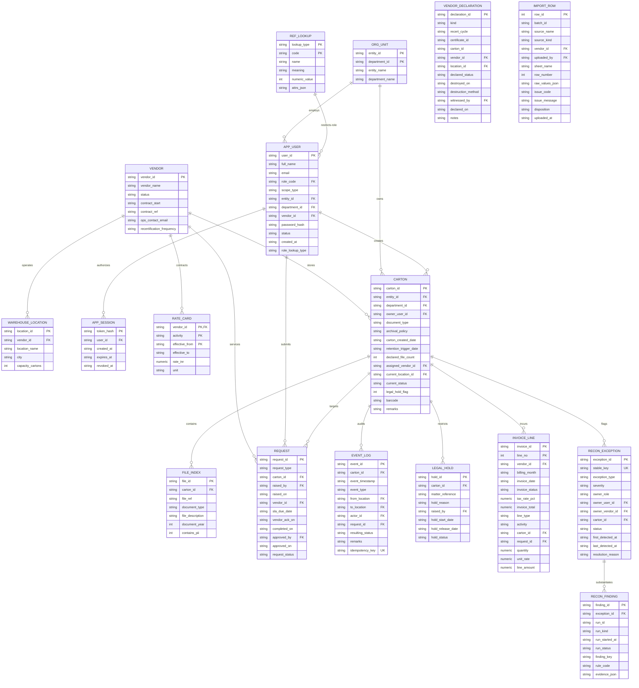

# Database Documentation — Physical Records Management System (PRMS)

## 1. Schema Overview & Design Philosophy

The PRMS database implements a **consolidated 16-table relational schema** in SQLite (v3.40+ compatible). This model is derived from the authoritative 37-table normalized PostgreSQL reference model (`PRMS_Database_Complete`), intentionally consolidated to deliver a compact, self-contained footprint optimized for embedded, single-node deployments.

### Consolidation Strategy & Invariants
- **Polymorphic Reference Dictionary (`ref_lookup`)**: Replaces 13 discrete lookup tables with a single unified table keyed by `(lookup_type, code)`.
- **Merged Entity Hierarchy (`org_unit`)**: Merges `business_entity` and `department` into a composite primary key `(entity_id, department_id)`.
- **Denormalized Projections (`carton`)**: Stores `current_status`, `current_location_id`, and `legal_hold_flag` directly on the `carton` row, absorbing what was previously a dynamically queried projection table (`carton_state`).
- **Inlined Evidence Structures**:
  - `invoice_line` inlines invoice header attributes per line item.
  - `recon_finding` inlines reconciliation run metadata (`run_id`, `run_kind`, `run_status`).
  - `import_row` inlines file batch metadata and validation issue fields.
- **Append-Only Triggers**: Strict SQLite `BEFORE UPDATE` and `BEFORE DELETE` triggers abort any modification or removal of audit evidence (`event_log`, `import_row`, `recon_finding`).
- **Dynamic Retention View (`carton_retention`)**: Calculates destruction due dates dynamically from policy configurations, flagging missing triggers or missing policies without inventing arbitrary dates.
- **Operational Session Table (`app_session`)**: Created dynamically by `user_repo.js` to manage secure session tokens without polluting the 16 core business tables.

---

## 2. Entity Relationship Diagram (ERD)



---

## 3. Comprehensive Table Data Dictionary

### Table 1: `ref_lookup`
- **Purpose**: Unified polymorphic dictionary consolidating roles, scope types, document types, archival policies, retention rules, carton statuses, event types, SLAs, thresholds, GST tax rates, holidays, and billable activities.
- **Used by**: `auth_service`, `event_engine`, `carton_service`, `carton_retention` view, repository queries.

| Column | Data Type | Nullable | Default | Constraints & Relationships | Description |
| :--- | :--- | :---: | :---: | :--- | :--- |
| `lookup_type` | `TEXT` | NO | — | Composite PK (Part 1) | Category identifier (e.g. `ROLE`, `DOC_TYPE`, `RETENTION_POLICY`, `CARTON_STATUS`, `EVENT_TYPE`, `SLA`). |
| `code` | `TEXT` | NO | — | Composite PK (Part 2) | Unique code within category (e.g. `BUSINESS`, `Client KYC`, `In Storage`). |
| `name` | `TEXT` | YES | NULL | — | Human-readable display label. |
| `meaning` | `TEXT` | YES | NULL | — | Semantic explanation or policy definition. |
| `numeric_value` | `INTEGER` | YES | NULL | — | Quantitative policy value: retention years, SLA days, threshold days, or tax pct × 100. |
| `attrs_json` | `TEXT` | YES | NULL | `CHECK (attrs_json IS NULL OR json_valid(attrs_json))` | JSON object containing complex attributes (e.g. event transition maps, trigger descriptions). |

---

### Table 2: `org_unit`
- **Purpose**: Represents internal banking organizational divisions. Combines the legal entity and regional department into a single record.
- **Used by**: `app_user`, `carton`, `scope.js`.

| Column | Data Type | Nullable | Default | Constraints & Relationships | Description |
| :--- | :--- | :---: | :---: | :--- | :--- |
| `entity_id` | `TEXT` | NO | — | Composite PK (Part 1) | Legal entity ID (e.g. `ENT-BRN`, `ENT-MF`, `ENT-GCC`). |
| `department_id` | `TEXT` | NO | — | Composite PK (Part 2) | Regional department ID (e.g. `DEP-BRN-DEL`, `DEP-MF-OPS`). |
| `entity_name` | `TEXT` | NO | — | — | Full legal entity name (e.g. Branch Banking, Mutual Fund). |
| `department_name`| `TEXT` | NO | — | — | Department title (e.g. Delhi Branch, MF Operations). |

- **Indexes**: `org_unit_entity_idx` on `(entity_id)`.

---

### Table 3: `vendor`
- **Purpose**: Master registry of contracted third-party records storage and logistics providers.
- **Used by**: `warehouse_location`, `app_user`, `rate_card`, `carton`, `request`, `invoice_line`, `vendor_declaration`.

| Column | Data Type | Nullable | Default | Constraints & Relationships | Description |
| :--- | :--- | :---: | :---: | :--- | :--- |
| `vendor_id` | `TEXT` | NO | — | Primary Key | Vendor identifier (e.g. `VND-001`, `VND-002`, `VND-003`). |
| `vendor_name` | `TEXT` | NO | — | — | Full legal vendor company name. |
| `status` | `TEXT` | NO | — | `CHECK (status IN ('Active','Terminated'))` | Contractual operating status. |
| `contract_start` | `TEXT` | YES | NULL | ISO-8601 Date (`YYYY-MM-DD`) | Date Master Services Agreement (MSA) commenced. |
| `contract_ref` | `TEXT` | YES | NULL | — | Contract reference / agreement code (e.g. `MSA-2018-114`). |
| `ops_contact_email`| `TEXT`| YES | NULL | — | Operations primary dispatch email. |
| `recertification_frequency` | `TEXT` | NO | `'Quarterly'` | — | Audit recertification interval. |

---

### Table 4: `warehouse_location`
- **Purpose**: Physical warehouse facilities owned and operated by storage vendors.
- **Used by**: `carton`, `event_log`, `vendor_declaration`.

| Column | Data Type | Nullable | Default | Constraints & Relationships | Description |
| :--- | :--- | :---: | :---: | :--- | :--- |
| `location_id` | `TEXT` | NO | — | Primary Key | Unique warehouse code (e.g. `LOC-MUM-01`, `LOC-DEL-01`). |
| `vendor_id` | `TEXT` | NO | — | `REFERENCES vendor(vendor_id)` | Operating vendor provider. |
| `location_name` | `TEXT` | NO | — | — | Facility facility name (e.g. Mumbai Warehouse - Bhiwandi). |
| `city` | `TEXT` | NO | — | — | Metropolitan city location. |
| `capacity_cartons`| `INTEGER`| YES | NULL | `CHECK (capacity_cartons >= 0)` | Maximum storage carton volume. |

- **Constraints**: `UNIQUE (vendor_id, location_id)`.

---

### Table 5: `app_user`
- **Purpose**: User identity registry storing roles, organizational/vendor boundaries, and password hashes.
- **Used by**: `auth_service`, `user_repo`, `security.js`, `carton_service`, `request_service`, `hold_service`.

| Column | Data Type | Nullable | Default | Constraints & Relationships | Description |
| :--- | :--- | :---: | :---: | :--- | :--- |
| `user_id` | `TEXT` | NO | — | Primary Key | Unique user identity code (e.g. `U-BIZ`, `U-VND`). |
| `full_name` | `TEXT` | NO | — | — | User's full display name. |
| `email` | `TEXT` | NO | — | Case-insensitive Unique Index | Login email address. |
| `role_code` | `TEXT` | NO | — | FK via generated column to `ref_lookup` | Role (`BUSINESS`, `VENDOR`, `COMPLIANCE`, `FACILITIES`). |
| `scope_type` | `TEXT` | NO | — | `CHECK (scope_type IN ('DEPARTMENT','VENDOR','GLOBAL'))` | Row-level boundary model. |
| `entity_id` | `TEXT` | YES | NULL | FK to `org_unit(entity_id, department_id)` | Required if `scope_type = 'DEPARTMENT'`. |
| `department_id` | `TEXT` | YES | NULL | FK to `org_unit(entity_id, department_id)` | Required if `scope_type = 'DEPARTMENT'`. |
| `vendor_id` | `TEXT` | YES | NULL | `REFERENCES vendor(vendor_id)` | Required if `scope_type = 'VENDOR'`. |
| `password_hash` | `TEXT` | YES | NULL | — | Scrypt hash (`scrypt$salt$derivedHex`). NULL if not provisioned. |
| `status` | `TEXT` | NO | `'ACTIVE'` | `CHECK (status IN ('ACTIVE','INACTIVE'))` | Account active status. |
| `created_at` | `TEXT` | NO | UTC ISO Now | — | Creation timestamp. |
| `role_lookup_type`| `TEXT`| NO | `'ROLE'` | `GENERATED ALWAYS AS ('ROLE') VIRTUAL` | Virtual column enabling composite FK into `ref_lookup`. |

- **Check Constraints**:
  - `DEPARTMENT`: `entity_id IS NOT NULL AND department_id IS NOT NULL AND vendor_id IS NULL`
  - `VENDOR`: `entity_id IS NULL AND department_id IS NULL AND vendor_id IS NOT NULL`
  - `GLOBAL`: `entity_id IS NULL AND department_id IS NULL AND vendor_id IS NULL`
- **Indexes**: `UNIQUE INDEX app_user_email_ci ON app_user (lower(email))`.

---

### Table 6: `rate_card`
- **Purpose**: Contracted vendor fee schedules for physical handling and monthly storage.
- **Used by**: Cost engine, invoice reconciliation, reference queries.

| Column | Data Type | Nullable | Default | Constraints & Relationships | Description |
| :--- | :--- | :---: | :---: | :--- | :--- |
| `vendor_id` | `TEXT` | NO | — | Composite PK (Part 1), `REFERENCES vendor` | Vendor billing code. |
| `activity` | `TEXT` | NO | — | Composite PK (Part 2), `CHECK (activity IN ('PICKUP','RETRIEVAL','RETURN','DESTRUCTION','STORAGE'))` | Billable event activity. |
| `effective_from` | `TEXT` | NO | — | Composite PK (Part 3), ISO Date | Start date of rate validity. |
| `effective_to` | `TEXT` | YES | NULL | `CHECK (effective_to IS NULL OR effective_to > effective_from)` | Exclusive upper bound date of rate validity. |
| `rate_inr` | `NUMERIC` | NO | — | `CHECK (rate_inr >= 0)` | Contracted unit rate in INR. |
| `unit` | `TEXT` | NO | — | `CHECK (unit IN ('PER_CARTON','PER_CARTON_MONTH'))` | Billing unit. Storage requires `PER_CARTON_MONTH`. |

- **Check Constraints**: `CHECK ((activity = 'STORAGE') = (unit = 'PER_CARTON_MONTH'))`.

---

### Table 7: `carton`
- **Purpose**: Core entity representing a physical records box. Denormalized to store current status, warehouse location, and legal hold state directly.
- **Used by**: `carton_service`, `carton_repo`, `event_engine`, `request_service`, `hold_service`, `carton_retention` view.

| Column | Data Type | Nullable | Default | Constraints & Relationships | Description |
| :--- | :--- | :---: | :---: | :--- | :--- |
| `carton_id` | `TEXT` | NO | — | Primary Key | Unique carton tracking barcode / identifier. |
| `entity_id` | `TEXT` | NO | — | Composite FK to `org_unit` | Owning legal entity. |
| `department_id` | `TEXT` | NO | — | Composite FK to `org_unit` | Owning department. |
| `owner_user_id` | `TEXT` | NO | — | `REFERENCES app_user(user_id)` | Creating business user. |
| `document_type` | `TEXT` | NO | — | Matches `ref_lookup(DOC_TYPE)` | Categorization of records contained. |
| `archival_policy` | `TEXT` | NO | — | Matches `ref_lookup(ARCHIVAL_POLICY)` | Archival schedule (`Standard`, `Banking`, etc.). |
| `carton_created_date`| `TEXT`| NO | — | ISO Date (`YYYY-MM-DD`) | Physical carton packaging date. |
| `retention_trigger_date`| `TEXT`| YES| NULL| ISO Date (`YYYY-MM-DD`) | Event date initiating retention clock (e.g. loan closure). |
| `declared_file_count`| `INTEGER`| YES| NULL| `CHECK (declared_file_count >= 0)` | Declared number of files packed. |
| `assigned_vendor_id`| `TEXT`| YES| NULL| `REFERENCES vendor(vendor_id)` | Primary assigned storage provider. |
| `current_location_id`| `TEXT`| YES| NULL| `REFERENCES warehouse_location(location_id)` | Current warehouse location (NULL if with Business). |
| `current_status` | `TEXT` | NO | `'Created'` | Matches `ref_lookup(CARTON_STATUS)` | Projected current lifecycle status. |
| `legal_hold_flag` | `INTEGER`| NO | `0` | `CHECK (legal_hold_flag IN (0,1))` | 1 if under active legal hold; otherwise 0. |
| `barcode` | `TEXT` | YES | NULL | — | External physical barcode sticker. |
| `remarks` | `TEXT` | YES | NULL | — | Free-text operational comments. |

- **Indexes**:
  - `carton_scope_idx` on `(entity_id, department_id)`
  - `carton_vendor_idx` on `(assigned_vendor_id)`
  - `carton_status_idx` on `(current_status)`
  - `carton_location_idx` on `(current_location_id)`

---

### Table 8: `file_index`
- **Purpose**: Itemized inventory of files and dossiers contained inside each carton.
- **Used by**: `carton_service`, `carton_repo`.

| Column | Data Type | Nullable | Default | Constraints & Relationships | Description |
| :--- | :--- | :---: | :---: | :--- | :--- |
| `file_id` | `TEXT` | NO | — | Primary Key | Unique file dossier identifier. |
| `carton_id` | `TEXT` | NO | — | `REFERENCES carton(carton_id)` | Parent carton container. |
| `file_ref` | `TEXT` | NO | — | — | External file account / customer reference. |
| `document_type` | `TEXT` | NO | — | — | Specific file record document classification. |
| `file_description`| `TEXT` | YES | NULL | — | Descriptive title or dossier details. |
| `document_year` | `INTEGER`| YES | NULL | `CHECK (document_year BETWEEN 1000 AND 9999)` | Year records were executed. |
| `contains_pii` | `INTEGER`| NO | `1` | `CHECK (contains_pii IN (0,1))` | 1 if contains personal identifiable info; 0 otherwise. |

- **Indexes**: `file_carton_idx` on `(carton_id)`.

---

### Table 9: `request`
- **Purpose**: Workflow tracking for physical logistics instructions (`PICKUP`, `RETRIEVAL`, `RETURN`, `DESTRUCTION`).
- **Used by**: `request_service`, `request_repo`.

| Column | Data Type | Nullable | Default | Constraints & Relationships | Description |
| :--- | :--- | :---: | :---: | :--- | :--- |
| `request_id` | `TEXT` | NO | — | Primary Key | Unique request instruction code. |
| `request_type` | `TEXT` | NO | — | `CHECK (request_type IN ('PICKUP','RETRIEVAL','RETURN','DESTRUCTION'))` | Nature of logistics request. |
| `carton_id` | `TEXT` | NO | — | `REFERENCES carton(carton_id)` | Subject carton. |
| `raised_by` | `TEXT` | NO | — | `REFERENCES app_user(user_id)` | Initiating business user. |
| `raised_on` | `TEXT` | NO | — | ISO-8601 Timestamp | Request submission timestamp. |
| `vendor_id` | `TEXT` | NO | — | `REFERENCES vendor(vendor_id)` | Assigned handling vendor. |
| `sla_due_date` | `TEXT` | YES | NULL | — | Target operational completion deadline. |
| `vendor_ack_on` | `TEXT` | YES | NULL | — | Timestamp vendor accepted instruction. |
| `completed_on` | `TEXT` | YES | NULL | — | Timestamp vendor completed instruction. |
| `approved_by` | `TEXT` | YES | NULL | `REFERENCES app_user(user_id)` | Compliance officer who approved destruction. |
| `approved_on` | `TEXT` | YES | NULL | — | Destruction approval timestamp. |
| `request_status` | `TEXT` | NO | — | `CHECK (request_status IN ('Open','In Progress','Completed','Rejected','Cancelled'))` | Request lifecycle status. |

- **Check Constraints**:
  - `CHECK (approved_by IS NULL OR approved_by <> raised_by)`: Enforces **separation of duties**.
  - `CHECK ((approved_by IS NULL) = (approved_on IS NULL))`
  - `CHECK (request_type = 'DESTRUCTION' OR approved_by IS NULL)`
  - Sequence checks: `vendor_ack_on >= raised_on`, `completed_on >= raised_on`, `approved_on >= raised_on`.
- **Indexes**:
  - `request_vendor_queue_idx` on `(vendor_id, request_status, raised_on)`
  - `request_carton_idx` on `(carton_id, raised_on)`
  - `request_raiser_idx` on `(raised_by, request_status)`

---

### Table 10: `event_log`
- **Purpose**: Canonical, append-only audit trail capturing every physical movement, custody change, hold action, and lifecycle milestone.
- **Used by**: `event_engine`, `event_repo`.

| Column | Data Type | Nullable | Default | Constraints & Relationships | Description |
| :--- | :--- | :---: | :---: | :--- | :--- |
| `event_id` | `TEXT` | NO | — | Primary Key | Unique event identifier (`EV-...`). |
| `carton_id` | `TEXT` | NO | — | `REFERENCES carton(carton_id)` | Affected carton. |
| `event_timestamp`| `TEXT` | NO | — | ISO-8601 Timestamp | When event physically occurred. |
| `event_type` | `TEXT` | NO | — | Matches `ref_lookup(EVENT_TYPE)` | Event classification. |
| `from_location` | `TEXT` | YES | NULL | `REFERENCES warehouse_location(location_id)` | Source physical warehouse location. |
| `to_location` | `TEXT` | YES | NULL | `REFERENCES warehouse_location(location_id)` | Destination physical warehouse location. |
| `actor_id` | `TEXT` | YES | NULL | `REFERENCES app_user(user_id)` | User or operator executing event. |
| `request_id` | `TEXT` | YES | NULL | `REFERENCES request(request_id)` | Associated request instruction. |
| `resulting_status`| `TEXT`| YES | NULL | Matches `ref_lookup(CARTON_STATUS)` | New carton status (NULL if unchanged). |
| `remarks` | `TEXT` | YES | NULL | — | Contextual audit notes. |
| `idempotency_key`| `TEXT` | YES | NULL | Unique Constraint | Deduplication key for command replays. |

- **Indexes**:
  - `event_replay_idx` on `(carton_id, event_timestamp, event_id)`
  - `event_request_idx` on `(request_id)`
- **Triggers**: `protect_event_log_upd` and `protect_event_log_del` block all `UPDATE` and `DELETE` queries.

---

### Table 11: `legal_hold`
- **Purpose**: Legal hold registry freezing cartons subject to pending litigation, audits, or subpoenas.
- **Used by**: `hold_service`, `hold_repo`, `request_service`.

| Column | Data Type | Nullable | Default | Constraints & Relationships | Description |
| :--- | :--- | :---: | :---: | :--- | :--- |
| `hold_id` | `TEXT` | NO | — | Primary Key | Unique hold reference (`H-...`). |
| `carton_id` | `TEXT` | NO | — | `REFERENCES carton(carton_id)` | Target restricted carton. |
| `matter_reference`| `TEXT`| NO | — | — | Case, litigation, or regulatory docket reference. |
| `hold_reason` | `TEXT` | NO | — | — | Formal legal explanation for restriction. |
| `raised_by` | `TEXT` | YES | NULL | `REFERENCES app_user(user_id)` | Compliance officer ordering hold. |
| `hold_start_date`| `TEXT`| NO | — | ISO-8601 Timestamp | Timestamp hold became effective. |
| `hold_release_date`| `TEXT`| YES| NULL| ISO-8601 Timestamp | Timestamp hold was formally released. |
| `hold_status` | `TEXT` | NO | `'ACTIVE'` | `CHECK (hold_status IN ('ACTIVE','RELEASED'))` | Hold status. |

- **Check Constraints**:
  - `CHECK (hold_release_date IS NULL OR hold_release_date >= hold_start_date)`
  - `CHECK ((hold_status = 'RELEASED') = (hold_release_date IS NOT NULL))`
- **Indexes**: `hold_active_idx` on `(carton_id) WHERE hold_status = 'ACTIVE'`.

---

### Table 12: `vendor_declaration`
- **Purpose**: Ingested external evidence from vendors regarding periodic inventory recertifications and formal destruction certificates.
- **Used by**: Reconciliation engines (inventory and certificates).

| Column | Data Type | Nullable | Default | Constraints & Relationships | Description |
| :--- | :--- | :---: | :---: | :--- | :--- |
| `declaration_id` | `TEXT` | NO | — | Primary Key | Unique declaration record identifier. |
| `kind` | `TEXT` | NO | — | `CHECK (kind IN ('RECERT','DESTRUCTION_CERT'))` | Declaration category. |
| `recert_cycle` | `TEXT` | YES | NULL | — | Quarterly audit cycle (e.g. `2026-Q1`). |
| `certificate_id` | `TEXT` | YES | NULL | — | Vendor destruction certificate reference number. |
| `carton_id` | `TEXT` | YES | NULL | No FK by design (raw vendor evidence) | Raw carton identifier declared by vendor. |
| `vendor_id` | `TEXT` | NO | — | `REFERENCES vendor(vendor_id)` | Reporting vendor provider. |
| `location_id` | `TEXT` | YES | NULL | `REFERENCES warehouse_location(location_id)` | Declared storage warehouse facility. |
| `declared_status`| `TEXT` | YES | NULL | — | Status asserted by vendor. |
| `destroyed_on` | `TEXT` | YES | NULL | ISO Date (`YYYY-MM-DD`) | Date destruction was executed. |
| `destruction_method`| `TEXT`| YES| NULL| — | Disposal method (e.g. `Incineration`, `Shredding`). |
| `witnessed_by` | `TEXT` | YES | NULL | `REFERENCES app_user(user_id)` | Audit witness user. |
| `declared_on` | `TEXT` | NO | — | ISO-8601 Timestamp | Submission timestamp of declaration. |
| `notes` | `TEXT` | YES | NULL | — | Auxiliary declaration metadata. |

- **Indexes**:
  - `decl_vendor_idx` on `(vendor_id, kind)`
  - `decl_carton_idx` on `(carton_id)`

---

### Table 13: `invoice_line`
- **Purpose**: Consolidated vendor billing lines containing both invoice header information and granular item charges.
- **Used by**: Invoice reconciliation engine.

| Column | Data Type | Nullable | Default | Constraints & Relationships | Description |
| :--- | :--- | :---: | :---: | :--- | :--- |
| `invoice_id` | `TEXT` | NO | — | Composite PK (Part 1) | Vendor invoice number. |
| `line_no` | `INTEGER`| NO | — | Composite PK (Part 2) | Sequential line number on invoice. |
| `vendor_id` | `TEXT` | NO | — | `REFERENCES vendor(vendor_id)` | Billing vendor provider. |
| `billing_month` | `TEXT` | YES | NULL | Format `YYYY-MM` | Covered calendar billing month. |
| `invoice_date` | `TEXT` | YES | NULL | ISO Date | Invoice issuance date. |
| `invoice_status` | `TEXT` | YES | NULL | — | Payment approval status. |
| `tax_rate_pct` | `NUMERIC`| YES | NULL | — | Invoiced tax percentage (e.g. 18.00). |
| `invoice_total` | `NUMERIC`| YES | NULL | — | Invoiced total gross sum. |
| `line_type` | `TEXT` | YES | NULL | — | Charge category (`STORAGE` or `ACTIVITY`). |
| `activity` | `TEXT` | YES | NULL | — | Activity type if applicable. |
| `carton_id` | `TEXT` | YES | NULL | `REFERENCES carton(carton_id)` | Invoiced carton. |
| `request_id` | `TEXT` | YES | NULL | `REFERENCES request(request_id)` | Invoiced request instruction. |
| `quantity` | `NUMERIC`| YES | NULL | — | Billed volume / carton count. |
| `unit_rate` | `NUMERIC`| YES | NULL | — | Billed rate per unit in INR. |
| `line_amount` | `NUMERIC`| YES | NULL | — | Line item subtotal before tax. |

- **Indexes**:
  - `invoice_vendor_idx` on `(vendor_id, billing_month)`
  - `invoice_request_idx` on `(request_id)`

---

### Table 14: `recon_exception`
- **Purpose**: Central register of all discrepancy cases identified through automated reconciliation or data quality checks.
- **Used by**: `recon_service`, `recon_repo`.

| Column | Data Type | Nullable | Default | Constraints & Relationships | Description |
| :--- | :--- | :---: | :---: | :--- | :--- |
| `exception_id` | `TEXT` | NO | — | Primary Key | Unique exception incident reference. |
| `stable_key` | `TEXT` | NO | — | Unique Constraint | Fingerprinted business key ensuring continuity across runs. |
| `exception_type` | `TEXT` | NO | — | — | Typology code (e.g. `INVENTORY_MISMATCH`, `INVOICE_ARITHMETIC_ERROR`). |
| `severity` | `TEXT` | NO | — | `CHECK (severity IN ('LOW','MEDIUM','HIGH','CRITICAL'))` | Risk impact severity. |
| `owner_role` | `TEXT` | NO | — | Role responsible for triage | Role owner (`FACILITIES`, `VENDOR`, `COMPLIANCE`). |
| `owner_user_id` | `TEXT` | YES | NULL | `REFERENCES app_user(user_id)` | Assigned investigating user. |
| `owner_vendor_id`| `TEXT` | YES | NULL | `REFERENCES vendor(vendor_id)` | Target vendor if dispute is vendor-assigned. |
| `carton_id` | `TEXT` | YES | NULL | `REFERENCES carton(carton_id)` | Subject carton if specific to a box. |
| `status` | `TEXT` | NO | `'OPEN'` | `CHECK (status IN ('OPEN','INVESTIGATING','RESOLVED','ACCEPTED_RISK'))` | Triage investigation status. |
| `first_detected_at`| `TEXT`| NO | — | ISO-8601 Timestamp | Timestamp discrepancy was first observed. |
| `last_detected_at` | `TEXT`| NO | — | ISO-8601 Timestamp | Timestamp discrepancy was most recently re-observed. |
| `resolution_reason`| `TEXT`| YES| NULL| — | Mandatory justification required when closing or accepting risk. |

- **Check Constraints**:
  - `CHECK (last_detected_at >= first_detected_at)`
  - `CHECK (status NOT IN ('RESOLVED','ACCEPTED_RISK') OR (resolution_reason IS NOT NULL AND trim(resolution_reason) <> ''))`
- **Indexes**:
  - `exc_queue_idx` on `(status, owner_role, severity)`
  - `exc_vendor_idx` on `(owner_vendor_id, status)`

---

### Table 15: `recon_finding`
- **Purpose**: Granular, run-specific evidence records substantiating an exception case. Run execution attributes are inlined.
- **Used by**: `recon_service`, `recon_repo`.

| Column | Data Type | Nullable | Default | Constraints & Relationships | Description |
| :--- | :--- | :---: | :---: | :--- | :--- |
| `finding_id` | `TEXT` | NO | — | Primary Key | Unique finding evidence record code. |
| `exception_id` | `TEXT` | NO | — | `REFERENCES recon_exception(exception_id)` | Parent exception case. |
| `run_id` | `TEXT` | NO | — | Inlined Run ID | Hash identifier of the generating reconciliation run. |
| `run_kind` | `TEXT` | NO | — | `CHECK (run_kind IN ('INVENTORY','INVOICE','CERTIFICATE','DATA_QUALITY'))` | Category of reconciliation run. |
| `run_started_at`| `TEXT` | NO | — | ISO-8601 Timestamp | Timestamp run was executed. |
| `run_status` | `TEXT` | NO | — | `CHECK (run_status IN ('RUNNING','COMPLETED','FAILED'))` | Run execution outcome status. |
| `finding_key` | `TEXT` | NO | — | Unique with `run_id` | Specific finding discriminator. |
| `rule_code` | `TEXT` | NO | — | — | Specific algorithmic rule that breached. |
| `evidence_json` | `TEXT` | NO | — | `CHECK (json_valid(evidence_json))` | Raw discrepancy payload and comparison metrics. |

- **Constraints**: `UNIQUE (run_id, finding_key)`.
- **Indexes**:
  - `finding_exc_idx` on `(exception_id)`
  - `finding_run_idx` on `(run_id, run_kind)`
- **Triggers**: `protect_finding_upd` and `protect_finding_del` enforce append-only immutability.

---

### Table 16: `import_row`
- **Purpose**: Raw staging table for external workbook rows. Batch and validation error fields are inlined directly onto each row.
- **Used by**: Workbook ingestion pipeline.

| Column | Data Type | Nullable | Default | Constraints & Relationships | Description |
| :--- | :--- | :---: | :---: | :--- | :--- |
| `row_id` | `INTEGER`| NO | AUTOINCREMENT | Primary Key | Unique staging sequence ID. |
| `batch_id` | `TEXT` | NO | — | Inlined Batch ID | Ingestion batch identifier. |
| `source_name` | `TEXT` | NO | — | — | Source filename or upload artifact. |
| `source_kind` | `TEXT` | NO | — | `CHECK (source_kind IN ('WORKBOOK','INVENTORY','INVOICE','CERTIFICATE'))` | Ingestion format type. |
| `vendor_id` | `TEXT` | YES | NULL | `REFERENCES vendor(vendor_id)` | Associated vendor provider. |
| `uploaded_by` | `TEXT` | YES | NULL | `REFERENCES app_user(user_id)` | User who executed upload. |
| `sheet_name` | `TEXT` | NO | — | — | Excel worksheet tab name. |
| `row_number` | `INTEGER`| NO | — | `CHECK (row_number > 0)` | 1-indexed row number in source sheet. |
| `raw_values_json`| `TEXT`| NO | — | `CHECK (json_valid(raw_values_json))` | Raw unparsed row cell map. |
| `issue_code` | `TEXT` | YES | NULL | — | Validation failure error code if rejected. |
| `issue_message` | `TEXT` | YES | NULL | — | Human-readable explanation of error. |
| `disposition` | `TEXT` | YES | NULL | `CHECK (disposition IS NULL OR disposition IN ('ACCEPTED','REJECTED','WARNING','DUPLICATE'))` | Staging outcome status. |
| `uploaded_at` | `TEXT` | NO | UTC ISO Now | — | Ingestion timestamp. |

- **Constraints**: `UNIQUE (batch_id, sheet_name, row_number)`.
- **Indexes**: `import_batch_idx` on `(batch_id)`.
- **Triggers**: `protect_import_row_upd` and `protect_import_row_del` enforce append-only immutability.

---

### Operational Table: `app_session`
- **Purpose**: Manages authenticated browser sessions. Created dynamically on demand by `user_repo.js` to decouple operational web sessions from the 16 core business tables.
- **Used by**: `auth_service`, `user_repo`.

| Column | Data Type | Nullable | Default | Constraints & Relationships | Description |
| :--- | :--- | :---: | :---: | :--- | :--- |
| `token_hash` | `TEXT` | NO | — | Primary Key | SHA-256 hex digest of the raw session token. |
| `user_id` | `TEXT` | NO | — | `REFERENCES app_user(user_id)` | Authenticated user identity. |
| `created_at` | `TEXT` | NO | UTC ISO Now | — | Session issue timestamp. |
| `expires_at` | `TEXT` | NO | — | ISO-8601 Timestamp | Session expiration timestamp. |
| `revoked_at` | `TEXT` | YES | NULL | ISO-8601 Timestamp | Timestamp session was logged out or revoked. |

---

## 4. Derived Views

### View: `carton_retention`
- **Purpose**: Computes destruction eligibility dates dynamically by joining `carton` records with retention policies defined in `ref_lookup`.
- **Definition**:
```sql
CREATE VIEW carton_retention AS
SELECT c.carton_id, c.entity_id, c.department_id, c.retention_trigger_date,
       rl.code AS policy_code, rl.numeric_value AS retention_years,
       CASE WHEN c.retention_trigger_date IS NOT NULL AND rl.code IS NOT NULL
            THEN date(c.retention_trigger_date, '+' || rl.numeric_value || ' years')
       END AS destruction_due_on,
       CASE WHEN c.retention_trigger_date IS NULL THEN 'MISSING_TRIGGER'
            WHEN rl.code IS NULL THEN 'MISSING_POLICY'
            ELSE 'CALCULATED' END AS calculation_status
FROM carton c
LEFT JOIN ref_lookup rl
  ON rl.lookup_type = 'RETENTION_POLICY'
 AND rl.code = c.document_type || '|' || c.archival_policy;
```
- **Business Behavior**:
  1. If `retention_trigger_date` is NULL, `calculation_status` outputs `'MISSING_TRIGGER'` and `destruction_due_on` remains NULL.
  2. If the policy combination (`document_type|archival_policy`) is not seeded in `ref_lookup`, `calculation_status` outputs `'MISSING_POLICY'`.
  3. When valid, SQLite's `date(..., '+N years')` function calculates the exact maturity date. Updating a policy's `numeric_value` in `ref_lookup` updates retention calculations across all cartons immediately without updating the underlying carton rows.

---

## 5. Reference Seed Data & Vocabulary Catalog

The reference seed (`backend/src/db/seed.sql`) populates `ref_lookup` with foundational business rules:

| Lookup Type | Codes Seeded | Description & Key Attributes |
| :--- | :--- | :--- |
| `ROLE` | `BUSINESS`, `VENDOR`, `COMPLIANCE`, `FACILITIES` | Maps each role to its corresponding `scope_type` (`DEPARTMENT`, `VENDOR`, `GLOBAL`). |
| `SCOPE_TYPE` | `DEPARTMENT`, `VENDOR`, `GLOBAL` | Architectural scope definitions. |
| `DOC_TYPE` | `Client KYC` (8y), `Loan Agreements` (10y), `Other Agreements and Vendor Data` (7y), `Vendor Onboarding` (7y), `Audit Reports` (10y), `Invoices` (8y), `Misc Documents` (5y) | Document classifications with baseline retention years and trigger definitions. |
| `ARCHIVAL_POLICY`| `Standard`, `Banking`, `Country Specific` | Archival classifications. |
| `RETENTION_POLICY`| 21 combinations (e.g. `Client KYC\|Standard`, `Loan Agreements\|Country Specific`) | Exact statutory retention years (`numeric_value`). |
| `CARTON_STATUS` | `Created`, `Pickup Requested`, `In Transit to Vendor`, `In Storage`, `Retrieval Requested`, `With Business`, `Return Requested`, `Destruction Requested`, `Approved for Destruction`, `Destroyed`, `Missing` | Lifecycle statuses. `Destroyed` is marked `is_terminal: true` in `attrs_json`. |
| `REQUEST_STATUS`| `Open`, `In Progress`, `Completed`, `Rejected`, `Cancelled` | Operational request workflow statuses. |
| `EVENT_TYPE` | 19 events (`CARTON_CREATED`, `PICKUP_REQUESTED`, `PICKED_UP_BY_VENDOR`, `RECEIVED_AT_WAREHOUSE`, `RETRIEVAL_REQUESTED`, `DELIVERED_TO_BUSINESS`, `RETURN_REQUESTED`, `DESTRUCTION_REQUESTED`, `DESTRUCTION_APPROVED`, `DESTROYED`, `INTER_WAREHOUSE_TRANSFER`, `LEGAL_HOLD_APPLIED`, `LEGAL_HOLD_RELEASED`, `REQUEST_ACKNOWLEDGED`, `REQUEST_REJECTED`, `REQUEST_CANCELLED`, `FILE_INDEXED`, `CERTIFICATE_LODGED`, `RECONCILIATION_RUN`) | State machine definition. `attrs_json` contains authorized `raised_by` roles, `from` status array, and `resulting_status`. |
| `SLA` | `PICKUP` (2d), `RETRIEVAL` (2d), `RETURN` (2d), `DESTRUCTION` (5d) | Operational SLA business days. |
| `THRESHOLD` | `In Transit to Vendor` (30d), `With Business` (90d), `Request open` (0d) | Escalation thresholds. |
| `TAX` | `GST-18` (1800) | 18% Goods and Services Tax. |
| `HOLIDAY` | 9 national holidays across 2025–2026 (Republic Day, Holi, Independence Day, Gandhi Jayanti, Diwali, Christmas) | Excluded from SLA business-day calculations. |
| `ACTIVITY` | `PICKUP`, `RETRIEVAL`, `RETURN`, `DESTRUCTION`, `STORAGE` | Billable vendor activities. |

---

## 6. Migration and Database Maintenance

### Database Initialization
To create an empty, fully seeded SQLite database file:
```bash
cd backend
npm run db:init
```
This runs `src/db/init.js`, which reads and applies [`src/db/schema.sql`](file:///c:/Users/hp/Desktop/16table/localproject/sqlite-app/backend/src/db/schema.sql) followed by [`src/db/seed.sql`](file:///c:/Users/hp/Desktop/16table/localproject/sqlite-app/backend/src/db/seed.sql).

### Environment Configuration
The database file location is governed by the `PRMS_DATABASE_FILE` environment variable (defaults to `./prms.db` if unset).

