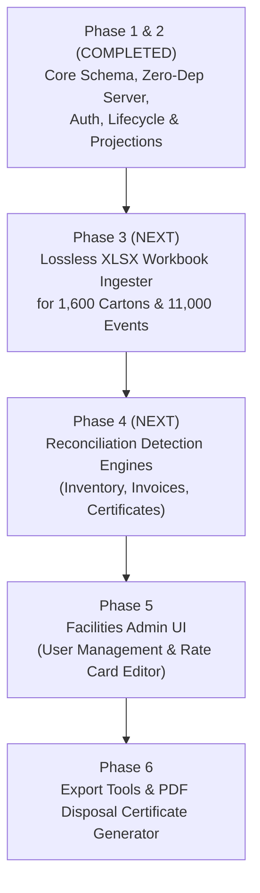

# Known Issues, Technical Debt & Roadmap — PRMS

## 1. Verified Incomplete Features & Limitations

Based on direct source code analysis, the following features are designed in the architecture and schema but remain partially implemented or stubbed in the current codebase:

### 1.1 Reconciliation Detection Engines (Stubbed)
- **Status**: Framework & Schema Implemented; Detection Algorithms Pending.
- **Evidence**: In [`backend/src/services/recon_service.js`](file:///c:/Users/hp/Desktop/16table/localproject/sqlite-app/backend/src/services/recon_service.js#L19-L22):
  ```javascript
  // Engine stub: no findings produced yet; a completed run with zero findings is
  // represented by the absence of recon_finding rows for this run_id.
  return { run_id: runId, status: "COMPLETED", deduplicated: false, findings: 0 };
  ```
- **Description**: The database tables (`recon_finding`, `recon_exception`), the deterministic fingerprinting algorithm, and the API endpoints exist. However, the three algorithmic comparison engines defined in `KIRO_PROJECT_CONTEXT.md` §13 have not yet been coded:
  1. *Inventory Engine*: Comparing `vendor_declaration` against actual internal warehouse custody at the declared timestamp.
  2. *Invoice Engine*: Validating invoice arithmetic and comparing billed activity against actual event logs and rate cards.
  3. *Certificate Engine*: Cross-referencing destruction certificates against requests, events, and legal hold intervals.

### 1.2 Lossless Excel Workbook Ingestion (Pending CLI/API)
- **Status**: Schema & Sample Dataset Present; Parser Not Yet Implemented.
- **Evidence**: `docs/2. prms_hackathon_dataset_v2.xlsx` exists with 1,600 cartons, 9,453 files, and 11,068 events. The `import_row` table is defined in `schema.sql` with JSON validation.
- **Description**: There is currently no automated script or HTTP endpoint that parses the 8 sheets of the workbook and populates `import_row`, `carton`, `file_index`, and `event_log`. Cartons are currently registered via API or test fixtures.

### 1.3 Rate Card Overlapping Window Validation
- **Status**: Documented Application Rule; Service Check Not Yet Implemented.
- **Evidence**: In `schema.sql` under table `rate_card`:
  ```sql
  -- Non-overlapping windows per (vendor,activity) enforced in services.
  ```
- **Description**: Because SQLite does not support PostgreSQL's `EXCLUDE USING gist` constraint, non-overlapping `effective_from` / `effective_to` date ranges must be validated in code. A reference maintenance service for rate cards has not yet been implemented.

### 1.4 Destruction Replay Idempotency Refinement
- **Status**: Minor Edge Case Behavior.
- **Evidence**: Retrying a `destroy` instruction on an already-destroyed carton returns an HTTP `409 CONFLICT` (because the carton is in a terminal state) rather than silently returning the original cached event response.

### 1.5 Facilities User Administration Screen
- **Status**: Backend user upsert repository exists (`user_repo.upsert`), but there is no frontend UI for Facilities users to deactivate accounts or update user roles. User provisioning is currently handled via the CLI script `scripts/create_user.js`.

---

## 2. Technical Debt & Codebase Observations

1. **Large Route Registration File**:
   - `backend/src/http/routes.js` contains 234 lines registering all 21 API endpoints in a single file. While clean and readable, as more endpoints are added (imports, reference administration), this should be split into modular route handlers (`routes/auth.js`, `routes/cartons.js`, `routes/requests.js`, etc.).
2. **Buffer-Based JSON Body Parsing**:
   - `backend/src/http/router.js` buffers the entire JSON payload in memory up to a 1,000,000-byte (1MB) threshold. For future bulk file uploads or workbook ingestion, streaming multipart decoders should be introduced.
3. **Floating Point vs. Exact Decimal Arithmetic**:
   - Money and rates are stored as `NUMERIC` / `TEXT` in SQLite. When the billing reconciliation engine is completed, all financial calculations must use an exact integer/decimal library (or compute integer paise/cents) rather than JavaScript standard floating-point math.

---

## 3. Security Considerations & Hardening Backlog

| Security Item | Current State | Target State | Priority |
| :--- | :--- | :--- | :---: |
| **CSRF Token Header** | Relies on `SameSite=Lax` cookies | Implement custom header validation (`X-PRMS-CSRF`) on all mutating requests | High |
| **Login Rate Limiter** | No throttling on `/auth/login` | Max 5 failed attempts per IP/account within 5 minutes | High |
| **Mandatory Session Secret** | Generates random fallback secret if missing | Process fails to boot in `production` mode if secret is unset | Medium |
| **Password Complexity Rules** | Accepts any string for password | Enforce minimum 10 characters, mixed case, and numbers | Medium |

---

## 4. Prioritized Feature Roadmap

Aligned with the phased implementation plan in `docs/KIRO_PROJECT_CONTEXT.md`:



### Phase 3: Lossless Workbook Ingestion Pipeline
- Develop a standalone Node script using a streaming XLSX reader.
- Parse `2. prms_hackathon_dataset_v2.xlsx`:
  - Preserve raw rows and validation errors in `import_row`.
  - Ingest `carton_inventory` into `carton`.
  - Ingest `file_index` into `file_index`.
  - Ingest `requests` into `request`.
  - Ingest `event_log` into `event_log` preserving original timestamps and actors.
  - Ingest `legal_holds` and sync active hold flags.
  - Ingest vendor declaration feeds, invoices, and certificates.

### Phase 4: Automated Reconciliation Engines
- **Inventory Engine**: Compare vendor recertification declarations with warehouse custody as of the declared timestamp. Surface `MISSING_AT_VENDOR`, `UNKNOWN_TO_BANK`, and `WRONG_WAREHOUSE` exceptions.
- **Invoice Engine**:
  - Pass 1: Recalculate line amounts (`quantity * unit_rate`) and compare against invoice totals and 18% GST.
  - Pass 2: Cross-reference storage charges against active warehouse custody intervals and activity fees against actual completed service requests.
- **Certificate Engine**: Cross-reference destruction certificates against destruction event logs. Detect cartons destroyed while under active legal holds (CRITICAL severity), reused certificate numbers, or cartons billed for storage after certificate issuance.

### Phase 5: Facilities Administration & Reporting
- Add frontend screens for Facilities to:
  - Deactivate users or update departmental assignments.
  - Manage rate card schedules and validate non-overlapping date windows.
  - Export filtered inventory and audit trail reports to CSV.

