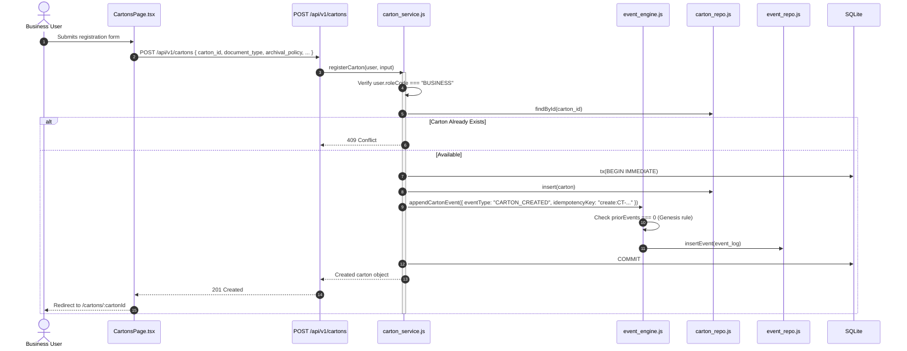
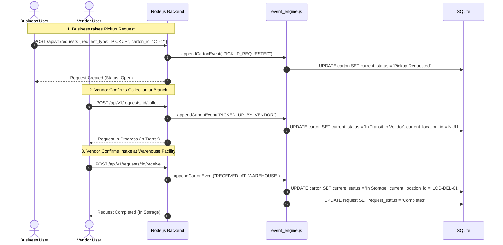

# Modules and Codebase — Physical Records Management System (PRMS)

## 1. Complete Repository File Structure

```text
sqlite-app/
├── .env.example                      # Reference environment variable template
├── .gitignore                         # Git exclusion rules (node_modules, db files, logs)
├── README.md                          # High-level project entrypoint and run guide
├── backend/                           # Node.js + SQLite backend service
│   ├── package.json                   # Backend scripts and Node >=22.5 engine requirement
│   ├── scripts/
│   │   └── create_user.js             # CLI tool to provision/update users with scrypt passwords
│   ├── src/
│   │   ├── config.js                  # Environment variable configuration parser
│   │   ├── errors.js                  # Standard AppError class and error status helpers
│   │   ├── security.js                # Scrypt hashing, timing-safe checks, session token helpers
│   │   ├── server.js                  # node:http server entrypoint, CORS, correlation tracking
│   │   ├── db/
│   │   │   ├── connection.js          # DatabaseSync instance, WAL config, tx() transaction helper
│   │   │   ├── init.js                # Database initialization script (applies schema + seed)
│   │   │   ├── schema.sql             # Consolidated 16-table schema + triggers + retention view
│   │   │   └── seed.sql               # Reference seed data (roles, statuses, policies, orgs)
│   │   ├── http/
│   │   │   ├── index.js               # HTTP module re-exports
│   │   │   ├── router.js              # Lightweight zero-dependency HTTP router and JSON body reader
│   │   │   └── routes.js              # REST endpoint registrations, auth/role guards, error mapping
│   │   ├── models/
│   │   │   ├── app_user.js            # User domain model, role definitions, public sanitizers
│   │   │   ├── carton.js              # Carton domain model, row-to-domain mappers
│   │   │   ├── event_log.js           # Event log entry domain model and history formatter
│   │   │   ├── file_index.js          # File dossier record model
│   │   │   ├── index.js               # Model re-exports and boolean/date conversion utilities
│   │   │   ├── legal_hold.js          # Legal hold model
│   │   │   ├── reconciliation.js      # Reconciliation exception and run model
│   │   │   └── request.js             # Service request model
│   │   ├── repositories/
│   │   │   ├── carton_repo.js         # Carton, file_index, and carton_retention SQL queries
│   │   │   ├── event_repo.js          # Event log insert, history lookup, and rule fetching SQL
│   │   │   ├── hold_repo.js           # Legal hold queries, active counts, and release updates
│   │   │   ├── index.js               # Repository re-exports
│   │   │   ├── recon_repo.js          # Reconciliation finding, run grouping, exception SQL
│   │   │   ├── request_repo.js        # Request queries, status updates, and vendor queue SQL
│   │   │   └── user_repo.js           # User lookups, upserts, and app_session storage SQL
│   │   └── services/
│   │       ├── auth_service.js        # Password authentication, session lifecycle management
│   │       ├── carton_service.js      # Carton registration, file indexing, retention lookup
│   │       ├── event_engine.js        # State machine transition engine, event appending, idempotency
│   │       ├── hold_service.js        # Legal hold application, release, and carton flag sync
│   │       ├── recon_service.js       # Reconciliation run deduplication and exception queries
│   │       ├── request_service.js     # Request raising, vendor ops, compliance destruction approval
│   │       └── scope.js               # Row-level authorization assertions across roles
│   └── tests/
│       └── lifecycle.test.js          # Node test suite (passwords, role FKs, holds, retention)
├── docs/                              # Project technical and business documentation
│   ├── API_DOCUMENTATION.md           # Complete REST API specifications
│   ├── DATABASE_DOCUMENTATION.md      # Complete database schema, ERD, and table dictionary
│   ├── DEVELOPMENT_GUIDE.md           # Engineering conventions and contribution instructions
│   ├── KNOWN_ISSUES_AND_ROADMAP.md    # Known limitations, tech debt, and implementation backlog
│   ├── MODULES_AND_CODEBASE.md        # Detailed codebase architectural breakdown (this file)
│   ├── PROJECT_OVERVIEW.md            # Problem statement, requirements, and user roles
│   ├── SECURITY.md                    # Security architecture and vulnerability assessment
│   ├── SETUP_AND_DEPLOYMENT.md        # Installation, configuration, and production run guides
│   ├── SYSTEM_ARCHITECTURE.md         # System components, diagrams, and runtime flows
│   ├── TECHNICAL_DECISIONS.md         # Architectural rationale and trade-off analysis
│   ├── TESTING.md                     # Test strategy, execution, and verification evidence
│   ├── api.md                         # Legacy quick-reference REST summary
│   ├── demo.md                        # 10-minute demonstration walkthrough script
│   ├── design.md                      # Legacy design notes and architecture summary
│   ├── roles.md                       # Legacy role permission matrix
│   ├── schema-translation.md          # 37-table to 16-table schema consolidation notes
│   ├── KIRO_PROJECT_CONTEXT.md        # Original problem brief and hackathon requirements
│   ├── 2. prms_hackathon_dataset_v2.xlsx # Reference source workbook containing test data
│   ├── 2026 Use Case - Physical Records Management System vfinalc0d4814.pdf # Original use case brief
│   └── 3. records_retention_policy_reference.docx # Statutory retention policy definitions
└── frontend/                          # React + TypeScript + Vite Single Page Application
    ├── index.html                     # HTML root template
    ├── package.json                   # Frontend dependencies (React 18, React Router 6, Vite 6)
    ├── tsconfig.json                  # TypeScript compiler configuration
    ├── vite.config.ts                 # Vite bundler configuration and /api proxy configuration
    └── src/
        ├── App.tsx                    # Root routing shell and role-based route guards
        ├── main.tsx                   # React DOM entrypoint
        ├── styles.css                 # Dark theme responsive design stylesheet
        ├── api/
        │   ├── client.ts              # Fetch wrapper, JSON serialization, and error decoding
        │   └── types.ts               # Shared TypeScript interfaces (Carton, Request, User, Role)
        ├── auth/
        │   └── AuthContext.tsx        # React Context managing session state and login/logout
        ├── components/
        │   └── Layout.tsx             # Shared navigation sidebar and user header layout
        └── pages/
            ├── CartonDetailPage.tsx   # Detailed carton view, request actions, history table
            ├── CartonsPage.tsx        # Carton lookup search and carton registration form
            ├── DashboardPage.tsx      # Role-scoped operational statistics and status breakdown
            ├── HoldsPage.tsx          # Legal hold register, hold application form, release prompt
            ├── LoginPage.tsx          # Email and password authentication screen
            ├── ReconciliationPage.tsx # Reconciliation run trigger form and historical runs table
            └── VendorQueuePage.tsx    # Vendor operational queue with action buttons
```

---

## 2. Backend Module Architecture & Responsibilities

### 2.1 HTTP & Server Layer (`backend/src/http/`, `backend/src/server.js`)
- **`server.js`**: Native HTTP server via `http.createServer`. Injects correlation IDs (`X-Correlation-Id`), handles CORS preflight requests (`OPTIONS`), handles `/health` endpoint directly, and delegates all other traffic to `Router`.
- **`router.js`**: Implements a zero-dependency path-matching router supporting dynamic segments (`:param`), streams incoming JSON bodies with a 1MB payload ceiling, parses cookies into key-value pairs, and formats JSON error envelopes.
- **`routes.js`**: Registers 21 REST API endpoints. Maps incoming HTTP parameters to domain service calls, runs authentication checks (`requireUser`) and role guards (`requireRoles`), sets `HttpOnly` session cookies on login, and returns serialized public models.

### 2.2 Security & Authentication Layer (`backend/src/security.js`, `backend/src/services/auth_service.js`)
- **`security.js`**:
  - `hashPassword(plain)`: Generates `scrypt$salt$derivedHex` using Node's `crypto.scryptSync`.
  - `verifyPassword(plain, stored)`: Verifies candidate passwords in constant time using `crypto.timingSafeEqual`.
  - `newSessionToken()`: Generates 32 bytes of cryptographically secure random data (`base64url`).
  - `hashToken(rawToken)`: Hashes raw token using SHA-256 for database lookup.
- **`auth_service.js`**:
  - `authenticate(email, password)`: Validates email, active user status, and scrypt hash.
  - `createSession(user)`: Inserts SHA-256 token hash into `app_session` with expiration date.
  - `resolveSession(rawToken)`: Validates active, non-expired, non-revoked session and returns domain user.
  - `revokeSession(rawToken)`: Sets `revoked_at` timestamp.

### 2.3 Scope & Authorization Layer (`backend/src/services/scope.js`)
- Enforces multi-tenant data isolation:
  - `assertCanViewCarton(user, carton)`: Restricts Business users to their department and Vendor users to their assigned vendor. Compliance and Facilities have global visibility.
  - `assertCanRaiseForCarton(user, carton)`: Restricts request creation to Business users owning the carton's department.
  - `assertCanActOnRequest(user, request)`: Restricts vendor operations to Vendor users assigned to that request.

### 2.4 Event Engine Layer (`backend/src/services/event_engine.js`)
- The core state machine and audit log manager:
  - `appendCartonEvent(...)`:
    1. Checks if `idempotencyKey` already exists in `event_log`. If found, returns existing event.
    2. Retrieves valid transitions and terminal flags from `ref_lookup`.
    3. Prevents state changes if carton is in the terminal `Destroyed` status.
    4. Validates that the carton's current status is present in the event's `from` array.
    5. Checks genesis constraints (events like `CARTON_CREATED` can only occur as the first event).
    6. Automatically assigns warehouse location when transitioning to warehouse custody (`In Storage`).
    7. Inserts immutable event record into `event_log`.
    8. Updates `carton` row's `current_status` and `current_location_id`.

### 2.5 Business Services Layer (`backend/src/services/`)
- **`carton_service.js`**: Validates registration permissions, ensures carton uniqueness, indexes physical files, and queries the `carton_retention` view.
- **`request_service.js`**: Validates request raising, checks active legal holds, manages vendor action flows (`acknowledge`, `collect`, `receive`, `deliver`), enforces compliance separation of duties for destruction approvals, and validates pre-execution holds for destructions.
- **`hold_service.js`**: Applies legal holds, records hold start dates, sets `carton.legal_hold_flag = 1`, and releases holds while clearing the flag only when zero active holds remain.
- **`recon_service.js`**: Manages reconciliation run fingerprints, provides idempotency checks, and queries scoped exceptions.

### 2.6 Data Access & Repositories (`backend/src/repositories/`)
- **`connection.js`**: Initializes SQLite in Write-Ahead Logging mode (`PRMA journal_mode = WAL;`) and exports `tx(fn)`, which executes callbacks inside `BEGIN IMMEDIATE` and `COMMIT/ROLLBACK` blocks.
- **`carton_repo.js`**: CRUD for cartons, file index insertions, retention view queries, and role-scoped dashboard count aggregations.
- **`event_repo.js`**: Appends events, queries event history in chronological order, and parses `ref_lookup` transition rules.
- **`hold_repo.js`**: Inserts holds, checks active holds for cartons, queries active hold counts, and records release timestamps.
- **`request_repo.js`**: Inserts requests, patches request fields (`vendor_ack_on`, `completed_on`, `approved_by`), and lists vendor work queues.
- **`user_repo.js`**: User queries by email or ID, user upserts, and manages the `app_session` operational table.
- **`recon_repo.js`**: Inlined finding inserts, historical run listings, and scoped exception filtering.

---

## 3. Frontend Architecture & Component Breakdown

The frontend is a lightweight Single Page Application built with React 18 and Vite:

### 3.1 Core Infrastructure (`frontend/src/`)
- **`api/client.ts`**: Provides `api.get<T>()` and `api.post<T>()`. Configured with `credentials: "include"` so HttpOnly cookies are automatically forwarded. Throws strongly typed `ApiError` instances containing error codes and messages.
- **`api/types.ts`**: Shared TypeScript definitions for `User`, `Carton`, `ServiceRequest`, `DashboardSummary`, and `CartonHistory`.
- **`auth/AuthContext.tsx`**: React context exposing `user`, `loading`, `login()`, and `logout()`. Checks `/auth/me` on initial load to restore sessions seamlessly across browser reloads.
- **`components/Layout.tsx`**: Two-column layout with a left sidebar displaying navigation links conditionally filtered by the active user's `role_code`, a user profile footer, and a logout button.

### 3.2 Pages (`frontend/src/pages/`)
- **`LoginPage.tsx`**: Centered authentication form submitting email and password.
- **`DashboardPage.tsx`**: Summarizes total cartons and open requests, and displays a dynamic breakdown table of cartons by lifecycle status.
- **`CartonsPage.tsx`**: Dual-purpose screen containing a carton lookup input by ID and a registration form for Business users to provision new cartons with document type, archival policy, and vendor assignment.
- **`CartonDetailPage.tsx`**: Comprehensive carton management screen showing:
  - Carton metadata and calculated retention due dates.
  - Interactive buttons for Business users to raise `Pickup`, `Retrieval`, `Return`, or `Destruction` requests.
  - Current projected state (Status, Warehouse Location, Legal Hold Flag).
  - Complete chronological event history table sourced from `event_log`.
- **`VendorQueuePage.tsx`**: Dedicated queue for Vendor users showing assigned requests with contextual action buttons (`Acknowledge`, `Collect`, `Receive at Warehouse`, `Deliver to Business`, `Execute destruction`).
- **`HoldsPage.tsx`**: Dedicated screen for Compliance and Facilities users. Displays all active legal holds, provides a form to apply new holds against cartons, and prompts for a mandatory reason when releasing holds.
- **`ReconciliationPage.tsx`**: Dedicated Facilities screen allowing users to launch `INVENTORY`, `INVOICE`, `CERTIFICATE`, or `DATA_QUALITY` reconciliation runs with scoped keys, displaying a summary table of previous runs and finding counts.

---

## 4. End-to-End Feature Execution Flows

### 4.1 Feature 1: Carton Registration & Genesis Event


---

### 4.2 Feature 2: Pickup, Collection, and Warehouse Receipt


---

### 4.3 Feature 3: Legal Hold Application & Destruction Refusal
```mermaid
sequenceDiagram
    autonumber
    actor Comp as Compliance Officer
    actor Biz as Business User
    actor Vnd as Vendor User
    participant Server as Node.js Backend
    participant HoldSvc as hold_service.js
    participant ReqSvc as request_service.js
    participant DB as SQLite

    Note over Comp, Server: 1. Compliance applies Legal Hold
    Comp->>Server: POST /api/v1/holds { carton_id: "CT-1", matter_reference: "LIT-01" }
    Server->>HoldSvc: applyHold(user, input)
    HoldSvc->>DB: INSERT INTO legal_hold (status: 'ACTIVE')
    HoldSvc->>DB: UPDATE carton SET legal_hold_flag = 1
    Server-->>Comp: 201 Created

    Note over Biz, Server: 2. Business attempts to raise Destruction
    Biz->>Server: POST /api/v1/requests { request_type: "DESTRUCTION", carton_id: "CT-1" }
    Server->>ReqSvc: raiseRequest(...)
    ReqSvc->>DB: SELECT * FROM legal_hold WHERE carton_id = 'CT-1' AND hold_status = 'ACTIVE'
    ReqSvc-->>Biz: 409 CONFLICT: "Carton is under an active legal hold; destruction is blocked"

    Note over Comp, Server: 3. Compliance Releases Hold
    Comp->>Server: POST /api/v1/holds/:id/release { reason: "Case dismissed" }
    Server->>HoldSvc: releaseHold(...)
    HoldSvc->>DB: UPDATE legal_hold SET hold_status = 'RELEASED'
    HoldSvc->>DB: UPDATE carton SET legal_hold_flag = 0
    Server-->>Comp: 200 OK (Hold Released)
```

