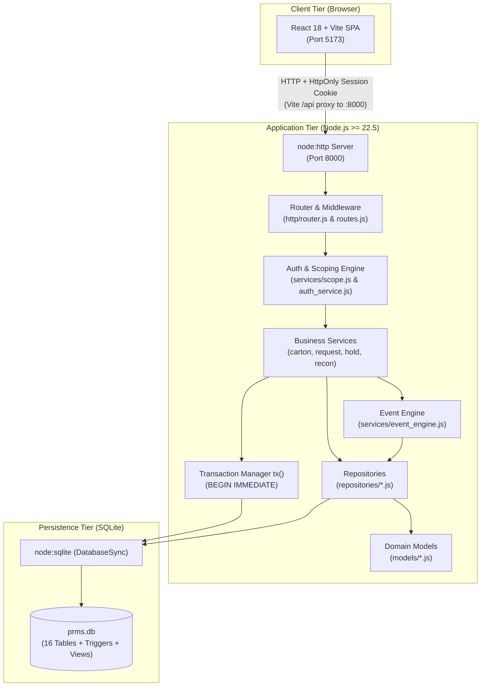
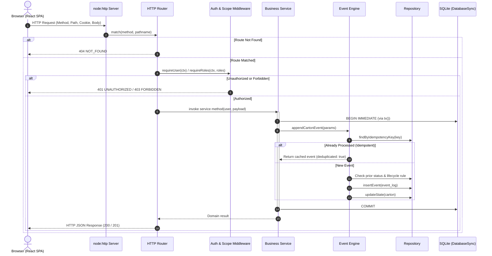
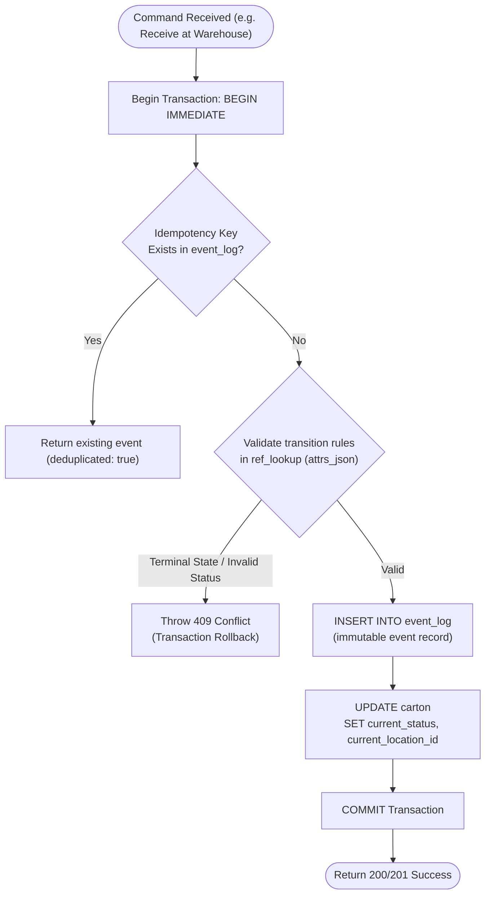
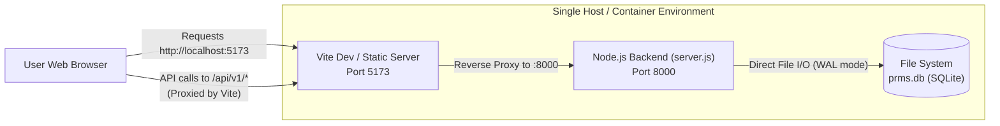

# System Architecture — Physical Records Management System (PRMS)

## 1. Architectural Philosophy & Overview

The Physical Records Management System (PRMS) is built as a **modular monolith** with a strict layered architecture and **zero runtime dependencies** on the backend. It balances operational simplicity, audit compliance, and strict domain boundaries.

The architecture strictly separates responsibilities into distinct layers:
1. **Presentation Layer (Frontend SPA)**: React 18, TypeScript, and Vite.
2. **Transport Layer (HTTP Router)**: Built over Node's native `node:http`. Handles request decoding, cookie parsing, parameter extraction, and status mapping.
3. **Domain Service Layer**: Encapsulates business rules, permission boundaries, role/row scoping, and the state-machine event engine.
4. **Data Access Layer (Repositories)**: Isolates SQL operations and maps database records into domain models.
5. **Storage & Persistence Layer**: Single embedded SQLite database utilizing Node's built-in `node:sqlite` (`DatabaseSync`), configured with Write-Ahead Logging (`WAL`) mode.



---

## 2. Layered Component Responsibilities

The codebase enforces strict unidirectional dependency rules:

```
Routes ──▶ Services ──▶ Repositories ──▶ Models ──▶ Database Connection
```

| Layer | Directory / Files | Responsibilities | Invariants & Constraints |
| :--- | :--- | :--- | :--- |
| **HTTP Transport** | `backend/src/http/` | URL matching, cookie parsing (`prms_session`), JSON payload streaming, HTTP status response serialization, and error translation. | **Zero business logic** or raw SQL queries allowed in route handlers. Handlers solely translate between HTTP and Services. |
| **Security & Identity** | `backend/src/security.js` | Scrypt password hashing with 16-byte random salts, timing-safe equality checks, opaque session token generation, and SHA-256 token hashing. | Raw tokens are never stored in the database; only SHA-256 digests are persisted in `app_session`. |
| **Domain Services** | `backend/src/services/` | Business rules, role permissions, row-level scope assertions (`scope.js`), workflow transitions, and state validations. | Services orchestrate operations and must wrap state-changing commands inside `tx()` blocks. |
| **Event Engine** | `backend/src/services/event_engine.js` | Validates lifecycle transitions against `ref_lookup` (`EVENT_TYPE`), checks idempotency keys, appends immutable events, and updates denormalized carton projections. | Runs inside `tx()` with `BEGIN IMMEDIATE` to guarantee atomic event append and projection sync. |
| **Repositories** | `backend/src/repositories/` | SQL statement preparation, query parameter binding, and result set execution against `db`. | All raw SQL statements live exclusively here. Repositories must return typed domain objects via Model mappers, never raw SQL rows. |
| **Domain Models** | `backend/src/models/` | Type definitions (JSDoc), snake_case to camelCase conversion, boolean casting (`0/1` <-> `true/false`), and public JSON sanitization. | Encapsulates domain entity structures and hides internal fields (e.g., stripping `password_hash`). |
| **Database Connection** | `backend/src/db/connection.js` | Instantiates `DatabaseSync`, enables foreign keys, configures WAL mode, sets `busy_timeout = 5000`, and provides the `tx(fn)` transaction helper. | Swapping SQLite drivers (e.g., to `better-sqlite3`) only requires modifying this single file. |

---

## 3. Component Interaction & Request-Response Lifecycle

Every incoming HTTP request undergoes a structured pipeline:



---

## 4. Authentication and Authorization Flow

### 4.1 Authentication Architecture
- Authentication uses **stateful sessions with opaque bearer tokens**.
- Passwords are encrypted using Node's native `scrypt` (`scryptSync(plain, salt, 64)`) with a unique 16-byte cryptographically secure salt.
- When a user logs in, a 32-byte cryptographically random token is generated (`newSessionToken()`) in base64url format.
- The server stores the **SHA-256 hash** of the token in the `app_session` table along with `user_id`, `created_at`, and `expires_at`.
- The raw token is sent to the client via an `HttpOnly`, `SameSite=Lax` session cookie (`prms_session`).
- On subsequent requests, the server hashes the cookie token with SHA-256, validates expiration and revocation in `app_session`, and loads the active user from `app_user`.

```mermaid
sequenceDiagram
    autonumber
    actor User as User Browser
    actor Client as Frontend (AuthContext)
    participant Route as /api/v1/auth/login
    participant Auth as auth_service.js
    participant Sec as security.js
    participant UserRepo as user_repo.js
    participant DB as SQLite

    User->>Client: Enters email and password
    Client->>Route: POST /api/v1/auth/login { email, password }
    Route->>Auth: authenticate(email, password)
    Auth->>UserRepo: findByEmail(email)
    UserRepo->>DB: SELECT * FROM app_user WHERE lower(email) = ?
    DB-->>UserRepo: User record with password_hash
    Auth->>Sec: verifyPassword(password, storedHash)
    Sec-->>Auth: Password Validated
    Auth->>Sec: newSessionToken() -> rawToken
    Auth->>Sec: hashToken(rawToken) -> tokenHash
    Auth->>UserRepo: createSession(tokenHash, userId, expiresAt)
    UserRepo->>DB: INSERT INTO app_session
    Auth-->>Route: User entity
    Route-->>Client: HTTP 200 OK + Set-Cookie: prms_session=rawToken; HttpOnly; SameSite=Lax
    Client-->>User: Redirect to Dashboard
```

### 4.2 Authorization & Multi-Tier Scoping
Access control is implemented in three defensive layers:

1. **Role Enforcement (`requireRoles`)**:
   Checks whether `user.roleCode` exists within the permitted roles for that endpoint (e.g., only `BUSINESS` can invoke `POST /api/v1/cartons`).
2. **Row-Level Scoping (`scope.js`)**:
   - `assertCanViewCarton(user, carton)`:
     - `BUSINESS`: `carton.entityId === user.entityId && carton.departmentId === user.departmentId`.
     - `VENDOR`: `carton.assignedVendorId === user.vendorId`.
     - `COMPLIANCE` / `FACILITIES`: Unrestricted global read access.
   - `assertCanRaiseForCarton(user, carton)`:
     - Only `BUSINESS` users can raise requests, and only for cartons owned by their department.
   - `assertCanActOnRequest(user, request)`:
     - Only `VENDOR` users can perform vendor operational tasks, and only for requests assigned to their `vendorId`.
3. **Field Redaction (Content Masking)**:
   - When `GET /api/v1/cartons/:cartonId/files` is accessed, if `user.roleCode === "VENDOR"`, the route throws HTTP 403 Forbidden. Vendors never receive file indexing or PII metadata.
   - When `GET /api/v1/exceptions` is accessed, vendors only see exceptions where `owner_vendor_id === user.vendorId`.

---

## 5. Event Engine & State Projection Sync

A core technical challenge in records management is maintaining an auditable event stream while delivering rapid status lookups. In the 16-table consolidated design:
- `event_log` is the **canonical, append-only history of truth**.
- `carton.current_status`, `carton.current_location_id`, and `carton.legal_hold_flag` are **denormalized projections** stored directly on the `carton` row.

### Command Execution Discipline
To eliminate drift between the audit log and the cached status:
1. Every command executes inside `tx(() => { ... })`.
2. `tx()` begins with `BEGIN IMMEDIATE` to acquire a write lock immediately and prevent concurrent writer interleaving.
3. If an `idempotency_key` is supplied and already recorded in `event_log`, the existing event is returned without executing further side effects.
4. The requested event is validated against `ref_lookup` (`EVENT_TYPE`) rules:
   - If the event causes a status change (`resulting_status != null`), the carton's current status must be in the `from` status array.
   - If the carton is in a terminal status (`Destroyed`), any transition is rejected.
   - Genesis events (`CARTON_CREATED`) are only allowed if `priorEvents === 0`.
5. The new `event_log` record is inserted.
6. The `carton` row's `current_status` and `current_location_id` are updated.
7. The transaction commits. If any step throws, the entire transaction rolls back.



---

## 6. Error-Handling Architecture

All application errors inherit from `AppError` ([`backend/src/errors.js`](file:///c:/Users/hp/Desktop/16table/localproject/sqlite-app/backend/src/errors.js)) and conform to a standard JSON error envelope:

```json
{
  "error": {
    "code": "CONFLICT",
    "message": "Carton is under an active legal hold; destruction is blocked",
    "fieldErrors": {},
    "correlationId": "550e8400-e29b-41d4-a716-446655440000"
  }
}
```

### Standard Error Hierarchy

| Error Function | Code | HTTP Status | Typical Use Case |
| :--- | :--- | :---: | :--- |
| `unauthorized(msg)` | `UNAUTHORIZED` | 401 | Missing, expired, or invalid session cookie; wrong password. |
| `forbidden(msg)` | `FORBIDDEN` | 403 | Attempting to access an unauthorized department/vendor or vendor requesting file index. |
| `notFound(msg)` | `NOT_FOUND` | 404 | Carton, request, hold, or route does not exist. |
| `conflict(msg)` | `CONFLICT` | 409 | Duplicate entity ID; illegal lifecycle transition; hold blocking destruction; self-approval. |
| `unprocessable(msg, fields)` | `UNPROCESSABLE` | 422 | Malformed payload; unrecognized request type or event type; payload exceeding 1MB limit. |
| Internal fallback | `INTERNAL` | 500 | Unhandled database exception or system fault. |

Each incoming request is stamped with an `x-correlation-id` header (or generated via `crypto.randomUUID()`) to trace requests from client to log files.

---

## 7. Deployment & Runtime Architecture

The project is structured to run as two co-located processes on a host or container:



1. **Development Mode**:
   - Backend runs on `http://localhost:8000` via `node --experimental-sqlite src/server.js`.
   - Frontend runs on `http://localhost:5173` via Vite. Vite proxies `/api` requests to `http://localhost:8000`, ensuring session cookies are treated as same-origin by browsers.
2. **Production Mode**:
   - Frontend builds to static assets via `tsc -b && vite build` (output to `frontend/dist/`).
   - Static assets can be served by a reverse proxy (Nginx, Caddy, or Node static middleware) that routes `/api/*` and `/health` to `localhost:8000`.
   - SQLite operates with persistent storage pointing to `PRMS_DATABASE_FILE=./prms.db`.

